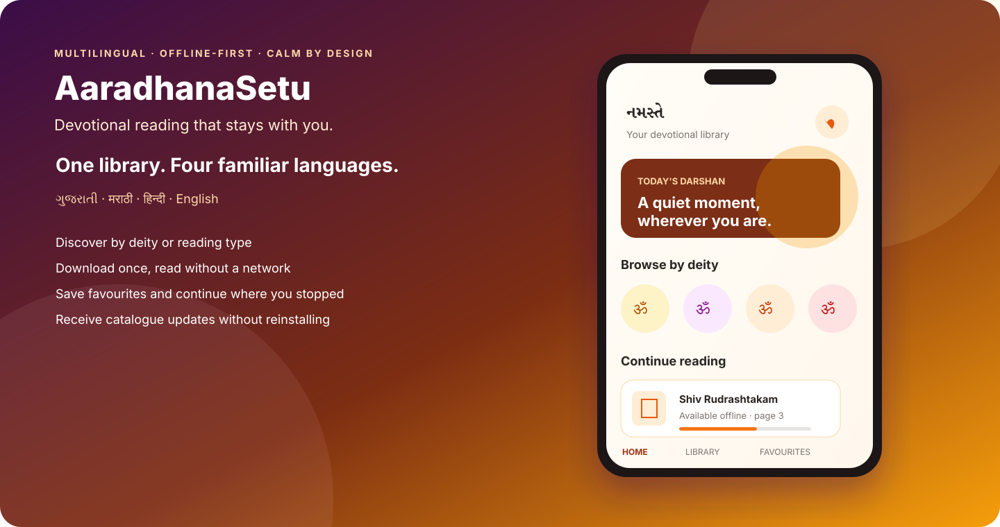

# AaradhanaSetu

> A multilingual, offline-first devotional library designed to keep trusted reading available even when the network is not.

  

  
  
  
  

## The product

AaradhanaSetu makes devotional PDFs easy to discover, download, save, and read across four languages. The mobile experience is built for people who may have intermittent connectivity, prefer familiar language choices, and need a calm interface instead of a crowded content feed.

The application pairs a reader-facing mobile app with a private publishing system. Approved editors can manage localized titles, document versions, deity imagery, ordering, and publication status without shipping a new app release for every catalogue change.

## What I built

- A multilingual Ionic React application packaged for Android and prepared for iOS through Capacitor.
- An offline-first library with starter content, verified downloads, favourites, recently opened items, and a PDF reader.
- Remote catalogue synchronization with checksums and immutable content versions.
- A private React publishing portal for localized metadata, PDFs, imagery, visibility, and ordering.
- Cloudflare Workers APIs backed by D1 metadata and private R2 object storage.
- Short-lived delivery authorization so private documents are not exposed as permanent public URLs.
- Public privacy and support pages plus an Android release workflow.

## Product decisions that mattered

| Challenge | Decision |
| --- | --- |
| Unreliable connectivity | Keep starter documents in the app and cache approved downloads for offline reading |
| Four-language content | Treat display language and document language as separate, explicit metadata |
| Safe document updates | Publish immutable versions with checksums instead of overwriting files in place |
| Private content delivery | Authorize downloads through the API and issue short-lived storage access |
| Small trusted editorial team | Protect the publisher portal separately from the public reader experience |
| Mobile release friction | Make catalogue and metadata changes server-driven wherever native changes are unnecessary |

## Architecture

  

The public diagram intentionally shows system boundaries without exposing live resource identifiers, credentials, private administration URLs, operational playbooks, or content files.

## AI-assisted engineering

AaradhanaSetu was built end to end with AI-assisted engineering: product discovery, architecture exploration, implementation, testing, multilingual content tooling, release preparation, and operational documentation. I remained responsible for product decisions, security boundaries, verification, and what was allowed to ship.

The useful lesson was not “AI wrote an app.” It was that disciplined AI collaboration can shorten the path from idea to a tested mobile product—provided every generated decision is reviewed against real constraints.

## Delivery status

- Android application ID and release signing path established.
- Versioned Android release bundle prepared for Google Play distribution.
- Public Google Play listing link will be added here once the listing is discoverable outside the owner/testing account.
- iOS project is generated and device testing is supported; App Store release work remains separate.

## Why the source repository is private

The production repository includes private infrastructure configuration, release and recovery procedures, publishing controls, and licensed/owner-supplied devotional content. Keeping that repository private is a security and content-rights decision, not an absence of working software.

This showcase contains no customer data, secrets, private URLs, source PDFs, or reusable credentials.

## About the builder

Built independently by [Rajesh Shah](https://github.com/iamrajshah), a lead engineer focused on product-minded backend, platform, mobile, and AI-assisted delivery.

Connect on [LinkedIn](https://www.linkedin.com/in/iamrajshah/).

---

This repository is a public product showcase. Source code and production assets are not licensed for reuse or redistribution.
